# БУНКЕР·9 — Сигнал тишины


**Браузерная социальная игра про выживание в бункере.** Пять–пятнадцать человек,
восемь личных карт, общий запас еды и один вопрос каждый день: кто останется
за столом, когда спасение ещё не пришло.

Никаких аккаунтов, установки и скачивания. Комната создаётся по ссылке, вход —
по четырёхзначному коду. Сервер на **Bun**, интерфейс — HTML по **SSE** через
**Datastar**, состояние — **SQLite**.

**Играть:** [bunker9.lol](https://bunker9.lol) · **Исходники:** [github.com/M1XXRON/-bunkero9](https://github.com/M1XXRON/-bunkero9)

<p align="center">
  
</p>

## Содержание

- [Как это играется](#как-это-играется)
- [Скриншоты](#скриншоты)
- [Правила](#правила)
- [Карты и спецвозможности](#карты-и-спецвозможности)
- [Экономика](#экономика)
- [Настройки и режимы](#настройки-и-режимы)
- [Мобильная версия](#мобильная-версия)
- [Технологии](#технологии)
- [Запуск](#запуск)
- [ИИ](#ии)
- [Тесты](#тесты)
- [Деплой](#деплой)
- [Структура](#структура)
- [Ограничения и планы](#ограничения-и-планы)

## Как это играется

Партия начинается со **сценария катастрофы** — без таймера. Все читают, кто где
заперт и что настораживает, жмут «Я прочитал», и только когда прочитали все
(или хост открыл день), начинается первый день.

Дальше цикл простой:

1. **Раскрытие.** По очереди выкладываете карты. В первый день — по две карты
   с каждого, дальше по одной. Очередь сдвигается каждый день.
2. **Обсуждение.** Смотрите на стол раскрытий, запасы и подсказки, решаете,
   кому верить.
3. **Голосование.** Изгоняете одного или воздерживаетесь. На карточке цели
   видно, как изменится суточный расход, если человек уйдёт.
4. **Кризис.** Сразу после голосования бункер проверяет еду и энергию. Если
   что-то на нуле — теряет одного. Медикаменты могут прикрыть один переход.
5. **Спасение.** Приходит после голосования последнего дня, но только если
   **еда и энергия не на нуле** и смена не опустилась ниже минимума.

Победа — дожить до сигнала извне. Поражение — «Бункер молчит»: кончились люди,
запасы или связь.

## Скриншоты

Все кадры ниже — актуальная визуальная редакция 2.0. Переснять их одной
командой (без `SITE` поднимется временный локальный сервер):

```bash
bun run shots
# только главная: ONLY=landing bun run shots
```

| Лобби                                          | Сценарий                                     |
| ---------------------------------------------- | -------------------------------------------- |
| 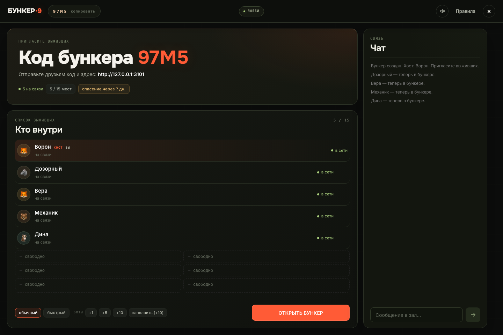             | 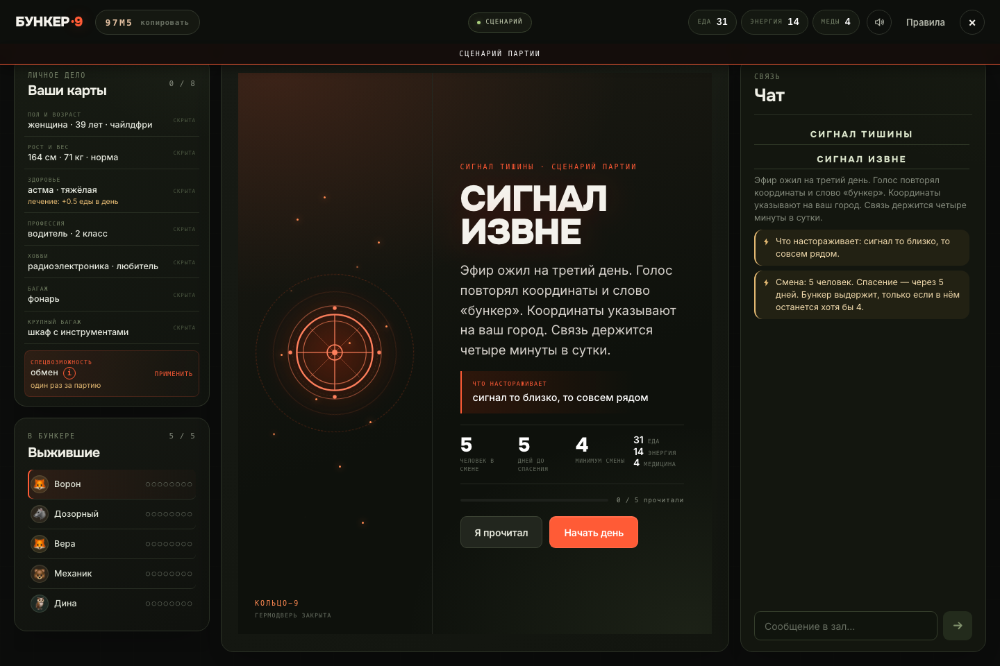     |
| **Раскрытие карт**                             | **Обсуждение**                               |
|         | 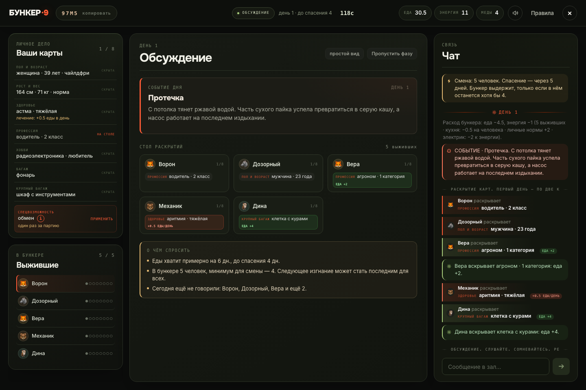 |
| **Спецвозможность**                            | **Голосование**                              |
| 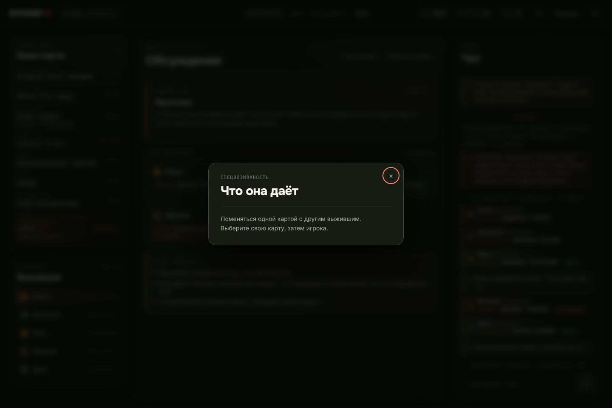 | 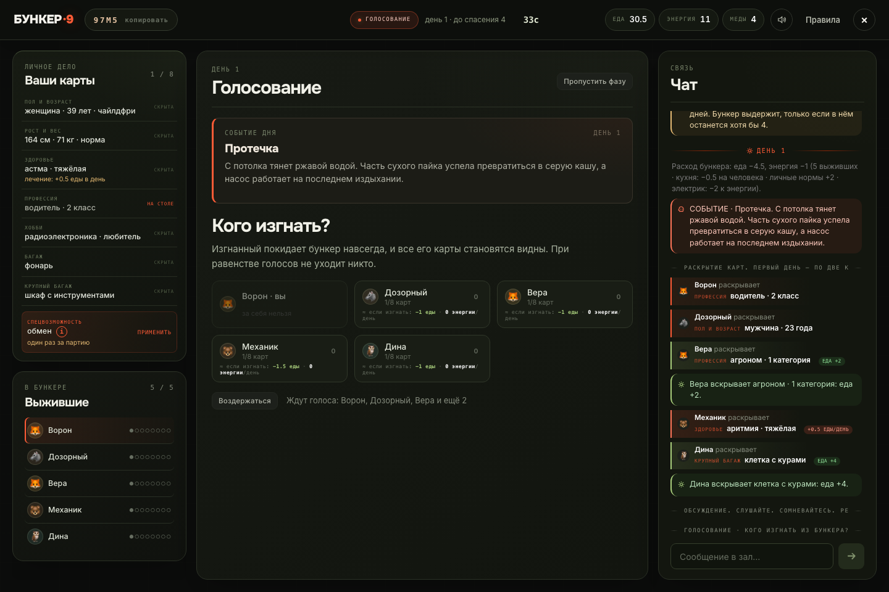      |

### Телефон

| Сценарий                                                  | Раскрытие                                                | Чат                                              |
| --------------------------------------------------------- | -------------------------------------------------------- | ------------------------------------------------ |
| 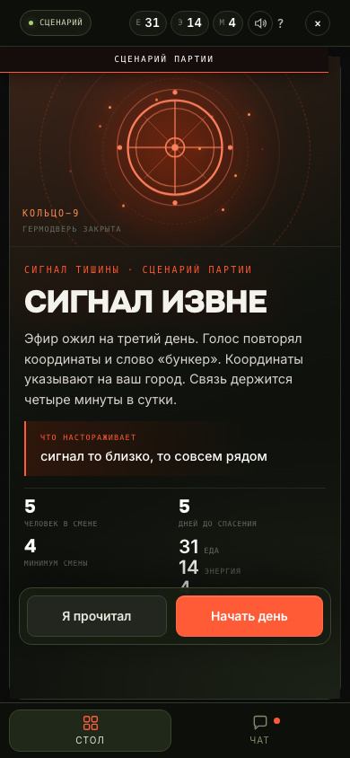 | 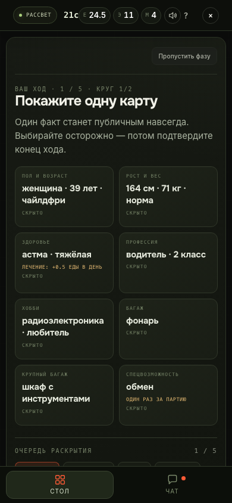 | 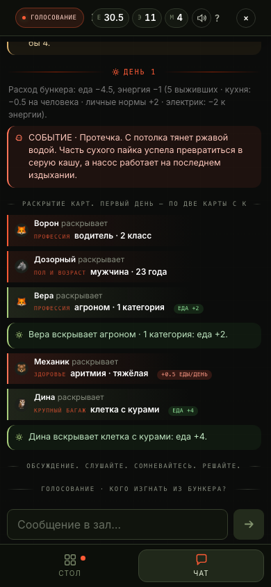 |

| Лендинг                                                 | Лобби                                               |
| ------------------------------------------------------- | --------------------------------------------------- |
| 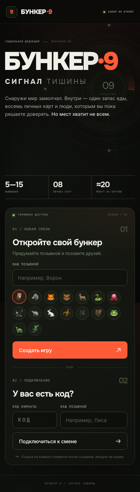 | 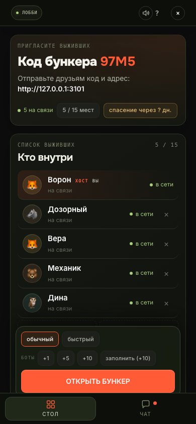 |

## Правила

### Сценарий

Отдельный экран без таймера: катастрофа, угроза, состав смены, запасы и день
спасения. Боты отмечаются автоматически, люди жмут «Я прочитал». Когда готовы
все — начинается день; хост может открыть его раньше.

### День

- **8 карт** у каждого: пол и возраст, рост и вес, здоровье, профессия, хобби,
  багаж, крупный багаж и спецвозможность.
- **Первый день — два круга раскрытия**, дальше по одному.
- Очередь каждый день начинается с другого игрока.
- Скрытые карты не раскрываются чужим клиентам — сервер отдаёт только
  категорию, без значения.
- Вскрытая карта подсвечивается: **зелёным** — приносит припасы или экономит
  расход, **красным** — увеличивает суточную норму.
- В обсуждении есть подсказки: сколько еды, сколько дней до спасения, кто
  молчит, у кого скрыта карта, сколько осталось медикаментов.

### Голосование

- Голосовать можно за любого живого, кроме себя, или воздержаться.
- Изгнан один лидер; при равенстве голосов или пустом бюллетене не уходит никто.
- На карточке цели: `≈ если изгнать: −1 еды · 0 энергии/день` — по раскрытым
  картам, без утечки скрытых эффектов.
- Изгнанный выбывает, его карты становятся видны.

### Кризис и финал

| Условие                                                | Итог                |
| ------------------------------------------------------ | ------------------- |
| после голосования последнего дня еда > 0 и энергия > 0 | **СПАСЕНИЕ ПРИШЛО** |
| живых меньше минимума смены                            | **БУНКЕР МОЛЧИТ**   |
| живых не осталось                                      | **БУНКЕР МОЛЧИТ**   |
| на последнем переходе еда или энергия на нуле          | **БУНКЕР МОЛЧИТ**   |

В финале раскрываются все карты, в ленте — разбор партии. Хост может запустить
рематч: состав и аватарки сохраняются, карты раздаются заново.

## Карты и спецвозможности

| Карта           | Пример                               | Что даёт                                                |
| --------------- | ------------------------------------ | ------------------------------------------------------- |
| Пол и возраст   | `женщина · 34 года · чайлдфри`       | без механики; у не-чайлдфри только пол и возраст        |
| Рост и вес      | `182 см · 119 кг · ожирение`         | полнота +0.25 еды/день, ожирение +0.5                   |
| Здоровье        | `астма · тяжёлая`                    | средняя степень +0.25, тяжёлая +0.5 еды/день            |
| Профессия       | `повар · 4 разряд`                   | повар кормит смену, электрик экономит энергию           |
| Хобби           | `радиодело · продвинуто`             | кулинария, ремонт, рыбалка, пчеловодство, первая помощь |
| Багаж           | `аптечка`, `ящик консервов`          | припасы в момент вскрытия                               |
| Крупный багаж   | `дизель-генератор`, `мешок картошки` | крупные припасы                                         |
| Спецвозможность | `обмен`, `НЗ`, `разведка`            | активная карта, одна на партию                          |

Эффект ищется по точному значению, затем по первому или последнему сегменту до
`·`: «повар · 4 разряд» работает как «повар», «астма · тяжёлая» — как
«тяжёлая». Поэтому ранги, степени и уровни навыка не ломают экономику.

Пока карта не раскрыта, её эффект бункеру недоступен — включая припасы.

### Спецвозможности

Одна на партию, только днём. Кнопка «применить» — в «Личном деле», полное
описание — по маленькой **i** рядом с картой.

| Карта        | Что делает                                                               |
| ------------ | ------------------------------------------------------------------------ |
| **Обмен**    | поменяться одной картой с выжившим: выбор своей карты → выбор игрока     |
| **НЗ**       | вскрыть запас: `+max(6, N)` еды, `+max(4, ⌈N/3⌉)` энергии, +1 медикамент |
| **Разведка** | посмотреть скрытые карты одного выжившего; видно только вам              |

Обмен меняет карты местами вместе с публичностью. Разведка приходит приватным
сообщением, остальные видят только, что игрок сверялся с досье.

## Экономика

Всё зависит от состава `N`: спасение, минимум смены, стартовые запасы, расход и
масштаб событий.

| Параметр              | Формула                                | 5 игроков | 15 игроков |
| --------------------- | -------------------------------------- | --------- | ---------- |
| День спасения `R`     | `4 + ⌈N/6⌉`                            | 5         | 7          |
| Минимум смены         | `max(3, ⌈0.7·N⌉)`                      | 4         | 11         |
| Стартовая еда         | `R·N + 6`                              | 31        | 111        |
| Стартовая энергия     | `max(2, ⌈N/3⌉)·R + 4`                  | 14        | 39         |
| Стартовые медикаменты | `2 + ⌈N/3⌉`                            | 4         | 7          |
| Расход еды в день     | `живые × (1 + кухня) + личные нормы`   | 5         | 15         |
| Расход энергии в день | `max(1, max(2, ⌈живые/3⌉) + электрик)` | 2         | 5          |

Стартовые запасы рассчитаны на все дни до спасения плюс небольшой буфер.
Спасение проверяется после кризиса последнего дня и требует ненулевых еды и
энергии, поэтому без изгнаний, припасов и удачных событий партия может
закончиться «Бункер молчит».

Ресурс в топбаре мигает красным, когда запас подходит к концу: `warn` — на два
дня, `crit` — на один. Мигание отключается при `prefers-reduced-motion`.

## Настройки и режимы

### Темп

| Фаза                  | Обычный     | Быстрый     |
| --------------------- | ----------- | ----------- |
| Сценарий              | без таймера | без таймера |
| Раскрытие (на игрока) | 25 с        | 15 с        |
| Обсуждение            | 120 с       | 60 с        |
| Голосование           | 35 с        | 20 с        |

Темп меняет только хост и только в лобби. В игре хост может пропустить
текущую фазу — это ускоряет партию, когда все уже высказались.

### Сценарии

Шесть статичных сценариев (`Химический шторм`, `Карантин`, `Долгая зима`,
`Тёмная вода`, `Сигнал извне`, `Последний состав`) выбираются случайно на
старте. Выбора сценария в интерфейсе нет. С ключом ИИ модель пишет свой
(`title` / `premise` / `threat`).

### Боты

Хост добивает состав ботами в лобби: `+1`, `+5`, `+10`, «заполнить». Бот —
обычный игрок с флагом `isBot`: раскрывает карты, голосует, проходит оба круга
первого дня и не занимает SSE-поток.

### Реконнект

- Cookie `bunker_sid` живёт 30 дней (`HttpOnly`, `SameSite=Lax`).
- Разрыв связи не убивает персонажа; вкладка возвращается по сессии.
- В лобби отключившийся удаляется через 120 с; в игре — остаётся.
- После рестарта сервера комнаты, сессии и текущая фаза поднимаются из SQLite,
  таймеры вооружаются заново, вкладки оживают по SSE без F5.
- Брошенная комната без живых потоков убирается через 30 минут.

## Мобильная версия

На экранах до 780 px интерфейс живёт в одном экране без прокрутки страницы:

- сверху компактная строка: фаза, таймер, ресурсы, правила и выход;
- снизу две вкладки — **Стол** и **Чат**; состояние переживает патчи Datastar;
- если нужен ваш ход или голос, а открыт чат, на «Столе» загорается точка;
- непрочитанный чат отмечается точкой, при старте партии из чата открывается стол;
- выжившие — горизонтальная лента, свои карты — две колонки;
- событие дня не показывается в раскрытии и голосовании: сначала действие;
- поле ввода закреплено над вкладками, высота учитывает `visualViewport` и
  клавиатуру.

Базовая мобильная раскладка — `@media (max-width: 780px)` в конце
`public/style.css`; адаптивная тема и состояния движения дополняют её в
`public/redesign.css`.

## Технологии

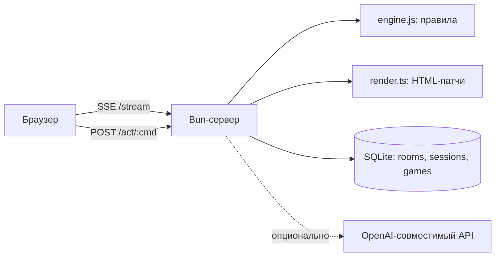

- **Bun** — HTTP, SSE, компиляция в один бинарник, `bun:sqlite`.
- **Datastar 1.0.5** — HTML-патчи по SSE, без фронтенд-фреймворка.
- **SQLite** — комнаты, сессии и история партий переживают рестарт.
- **SSE-сжатие** — zstd, фолбэк brotli, `identity` по `Accept-Encoding`.
  Cloudflare срезает zstd, поэтому через прод обычно уходит brotli.
- **Синтез звука** — WebAudio в `public/sound.js`, без аудиофайлов.
- **Визуальная редакция 2.0** — `public/redesign.css`: тёмная индустриальная
  палитра, анимированный гермозатвор, отзывчивые карточки и входные анимации.
  Анимации уважают `prefers-reduced-motion`, внешних JS-библиотек нет.
- **Никаких npm-зависимостей в рантайме.**

## Запуск

Нужен **Bun 1.1+**. На этой машине — `~/.bun/bin/bun` (1.4.4).

```bash
cd ~/Desktop/bunker
bun start                 # http://localhost:3100
```

Сервер печатает адрес в локальной сети. Друзьям нужен только браузер: они
открывают ссылку и вводят код комнаты.

```bash
cloudflared tunnel --url http://localhost:3100
# или
ngrok http 3100
```

### Переменные окружения

| Переменная             | По умолчанию                  | Назначение                                         |
| ---------------------- | ----------------------------- | -------------------------------------------------- |
| `PORT`                 | `3100`                        | порт HTTP-сервера                                  |
| `HOST`                 | `0.0.0.0`                     | интерфейс; на проде `127.0.0.1`                    |
| `PUBLIC_DIR`           | `./public`                    | каталог статики                                    |
| `BUNKER_DB`            | `./data/bunker.db`            | путь к SQLite                                      |
| `BUNKER_IDLE_MIN`      | `30`                          | через сколько минут убирать брошенную комнату      |
| `BUNKER_TEST`          | —                             | ускоренные таймеры для тестов                      |
| `BUNKER_AI`            | `live` при ключе, иначе `off` | `live` / `mock` / `off`                            |
| `BUNKER_AI_KEY`        | —                             | ключ OpenAI-совместимого API                       |
| `BUNKER_AI_URL`        | `https://api.openai.com/v1`   | базовый URL                                        |
| `BUNKER_AI_MODEL`      | `gpt-4o-mini`                 | модель                                             |
| `BUNKER_AI_TIMEOUT_MS` | `12000`                       | таймаут одного вызова                              |
| `BUNKER_AI_REASONING`  | —                             | `reasoning_effort`: GLM — `low`, DeepSeek — `none` |
| `BUNKER_AI_SESSION`    | случайный на процесс          | id сессии для OpenCode Go                          |

Служебные точки: `GET /health`, `GET /api/games`, `GET /stream` (SSE),
`POST /act/:cmd` (действия).

## ИИ

Пять функций, все опциональны и с фолбэками — без ключа игра работает как
раньше:

| Что                         | Без ключа                        |
| --------------------------- | -------------------------------- |
| Сюжет партии                | сценарий из `content.js`         |
| Персонажи: N×8 карт в лобби | карты из пулов                   |
| Событие дня                 | 22 статичных события             |
| Подсказки на обсуждении     | арифметика `discussionHints`     |
| Разбор партии в финале      | детерминированная сводка из лога |

Модель не блокирует фазы: вызовы асинхронные, ошибка или таймаут = фолбэк.
Персонажи ограничены по экстремумам: на 5–8 игроков максимум одно ожирение и
одна тяжёлая болезнь, на 9–15 — не больше двух.

Проверка без сети: `bun tools/ai-e2e.mjs` (входит в `verify`).

## Тесты

```bash
bun run verify              # гейт: типы, формат, боты 5/15, HTTP, ходы,
                            # экономика, ИИ, характеристики, способности,
                            # правила, игровые боты
SKIP_BOTS=1 bun run verify  # только типы и формат
```

`verify` сам поднимает серверы на свободных портах с временными базами —
рядом ничего держать не нужно.

| Команда                                             | Что проверяет                                     |
| --------------------------------------------------- | ------------------------------------------------- |
| `bun test/sim-bun.mjs` · `BOTS=15 …`                | партия ботов по HTTP/SSE, приватность карт        |
| `bun tools/http-e2e.mjs`                            | лендинг, вход, ошибки форм, сценарий, таймеры     |
| `bun tools/stale-session-e2e.mjs`                   | протухшая сессия и повторный вход                 |
| `bun tools/turn-e2e.mjs`                            | пошаговое раскрытие, два круга первого дня        |
| `bun tools/traits-e2e.mjs`                          | эффекты карт, цена изгнания, баланс колоды        |
| `bun tools/ability-e2e.mjs`                         | НЗ, обмен, разведка, приватность, ограничения     |
| `bun tools/economy-e2e.mjs`                         | стартовые запасы и суточный расход по составу     |
| `bun tools/rules-e2e.mjs`                           | голос за себя, спасение, ready, очередь, антифлуд |
| `bun tools/ai-e2e.mjs`                              | ИИ на `BUNKER_AI=mock`                            |
| `bun tools/bots-e2e.mjs`                            | боты в лобби и самостоятельная партия             |
| `bun tools/db-e2e.mjs`                              | персистентность: рестарт, комната, фаза, история  |
| `bun tools/ui-e2e.mjs`                              | таймер, оживание вкладки, реконнект               |
| `SITE=http://localhost:3102 bun tools/deep-e2e.mjs` | полная партия в браузере + мобилка                |
| `bun tools/balance-sim.mjs`                         | симуляция партий: винрейты, дни, кризисы          |

`sim-bun` и `http-e2e` ходят на готовый сервер по `SITE` (по умолчанию
`http://localhost:3101`), остальные поднимают свой. `deep-e2e` требует
запущенный сервер на `:3102`.

Браузерные проверки ищут `chrome-headless-shell` в кеше Playwright
(`~/Library/Caches/ms-playwright/chromium_headless_shell-1254/…`); на другой
машине путь нужно поправить.

## Деплой

```bash
VPS_HOST=<ip> ./deploy/vps/deploy.sh   # verify внутри — гейт перед выкладкой
./deploy/smoke.sh                      # проверка домена снаружи
```

Схема прода: `интернет → Cloudflare → Caddy (TLS) → bunker9.service :3100 →
SQLite`. Сервис слушает `127.0.0.1`; наружу выставлен Caddy. Бинарник
собирается локально (`bun build --compile --bytecode --target=bun-linux-x64`) и
копируется по ssh; Bun на сервере не нужен.

## Структура

```text
server.ts            Bun.serve: SSE /stream, POST /act/:cmd, лендинг, статика
src/engine.js        комнаты, фазы, раскрытие, экономика, голосование, кризис
src/render.ts        состояние → HTML (патчи по id для Datastar)
src/store.ts         bun:sqlite: rooms, sessions, games; отложенная запись
src/ai.ts            OpenAI-совместимый клиент, пять генераторов, mock
src/content.js       карты, эффекты, спецвозможности, события, сценарии
public/              style.css + redesign.css, sound.js, vendor/datastar-1.0.5.js
tools/               e2e-проверки, balance-sim, снимки UI
test/sim-bun.mjs     боты по HTTP/SSE
deploy/              smoke, туннель, vps/ (bootstrap, deploy, systemd, Caddy)
data/                bunker.db (в git не попадает)
screenshots/         актуальные кадры десктопа и телефона
```

## Ограничения и планы

- Нет аккаунтов, модерации и бана: игра рассчитана на друзей.
- Один процесс — одна общая комната-сервер; несколько комнат живут
  одновременно, горизонтального масштабирования нет.
- Напрямую TLS нет: в проде его держит Caddy, локально — туннель.
- Боты не используют спецвозможности.
- Браузерные тесты привязаны к macOS и кешу Playwright.
- `tools/audit-mobile.mjs` — наследие эпохи socket.io, требует отсутствующий
  `socket.io-client`; мобилку смотреть через `deep-e2e`.

Ближайшие идеи: аккаунты и статистика, модерация, личные цели на партию,
боты со спецвозможностями, EN-локализация, свайп между «Столом» и «Чатом».

---

<p align="center">
  <sub>БУНКЕР·9 · Bun + Datastar + SQLite · сделано для друзей в одном Wi-Fi и не только</sub>
</p>
