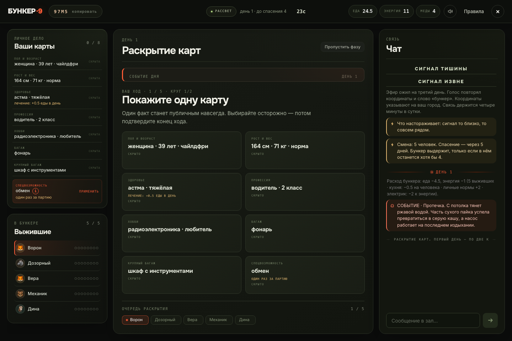

# БУНКЕР·9 — Сигнал тишины

Браузерная социальная игра для друзей на **5–15 человек**, собранная из двух жанров: «Бункера» и «Мафии». Комната создаётся по ссылке, аккаунты не нужны.

После Тишины вы заперты в бункере «Кольцо-9». У каждого — пять личных карт и одна скрытая роль. Днём вы раскрываете по одной карте и решаете, кого изгнать. Ночью заражённые выбирают жертву, а врач пытается её спасти. Еда, энергия и медикаменты заканчиваются быстрее, чем доверие.

## Скриншоты




Все кадры лежат в `screenshots/`.

## Что внутри

- Комнаты на 5–15 игроков, вход по коду или ссылке.
- Роли: **Живой**, **Врач**, **Заражённый**.
- Пять категорий карт персонажа: профессия, здоровье, багаж, факт, привычка.
- Ежедневное раскрытие одной карты, обсуждение и открытое голосование.
- Ночные действия заражённых и врача, расход медикаментов.
- Ресурсы бункера: еда, энергия, медикаменты; события, кризисы и случайные смерти при нуле.
- Чат зала, шёпот заражённых и чат мёртвых. Сервер выдаёт каждому только те сообщения, которые ему разрешено видеть.
- Таймеры, реконнект по сохранённой сессии, передача роли хоста, рематч.
- Адаптивный интерфейс для телефона и компьютера.

## Быстрый старт

Нужен Node.js 20+.

```bash
cd ~/Desktop/bunker
npm install
npm start
```

Откройте `http://localhost:3000`. Сервер также напечатает адрес в локальной сети:

```
http://192.168.x.x:3000
```

Хост создаёт бункер, копирует ссылку и отправляет друзьям. Если хост открыл игру через `localhost`, ссылка-приглашение автоматически подставит сетевой адрес сервера.

## Игра по сети

**Локальная сеть (один Wi-Fi):** откройте `http://<IP-хоста>:3000`, включите доступ к порту `3000` в файрволе macOS, если система спросит. Игрокам нужен только браузер.

**Через интернет:** проще всего поднять временный туннель:

```bash
cloudflared tunnel --url http://localhost:3000
# или
ngrok http 3000
```

Сервис выдаст публичный `https://...`-адрес. Открывайте игру по нему — ссылки-приглашения будут использовать этот же домен. Альтернатива — проброс порта на роутере, но тогда нужен внешний IP и настройка firewall.

## Правила

### Состав

| Игроков | Заражённых | Врач | Обычных   |
| ------- | ---------- | ---- | --------- |
| 5       | 1          | 1    | 3         |
| 6–9     | 2          | 1    | остальные |
| 10–12   | 3          | 1    | остальные |
| 13–15   | 4          | 1    | остальные |

Заражённые знают друг друга. Врач — человек с ночным действием.

### День

1. **Раскрытие.** Каждый живой выкладывает одну свою карту. Это видят все. Пять дней — пять раскрытых фактов. Если не выбрать карту, она раскроется случайно.
2. **Обсуждение.** Сопоставляйте карты, реакции, ночные потери и голоса.
3. **Голосование.** Изгоняется игрок с наибольшим числом голосов. При равенстве не уходит никто. Изгнанный выбывает, его роль раскрывается.

### Ночь

- Заражённые вместе выбирают жертву. Голоса суммируются, при равенстве цель выбирается случайно. Если заражённые не успели, цель тоже выберет случай.
- Врач может спасти одного выжившего (включая себя), потратив **1 медикамент**. Нельзя спасать одного и того же две ночи подряд. Если врач не выбрал цель, медикаменты сохраняются.
- Утром бункер узнаёт, кто не проснулся, и какова была его роль.

### Ресурсы

- **Еда** тратится каждое утро: 1 единица на каждого живого.
- **Энергия** убывает на 3 каждое утро и меняется событиями.
- **Медикаменты** тратит врач.
- Если еда или энергия падают до нуля, на рассвете погибает один случайный выживший. Еду и энергию можно пополнить событиями.

### Победа

- **Живые** побеждают, когда не остаётся ни одного заражённого.
- **Заражённые** побеждают, когда их становится не меньше, чем живых.
- Если в бункере не осталось никого — фиксируется ничья/«бункер молчит».

## Управление

- Хост видит кнопку пропуска фазы внизу сцены. Пропуск действует на всю комнату.
- Темп («Обычный» / «Быстрый») меняется в лобби.
- «Досье» открывает роль и личные карты. Пока роль не открыта, экран показывает только заглушку — на случай чужих глаз.
- Клик по выжившему открывает его досье с уже раскрытыми картами.
- При потере связи клиент переподключается по токену в `localStorage`. После явного выхода вернуться в идущую игру нельзя.

## Разработка

```
.
├── server.js          HTTP + Socket.IO, статика, сессии сокетов
├── src/
│   ├── engine.js      комнаты, роли, фазы, таймеры, права, сериализация state
│   └── content.js     карты, события, финалы, аватары
├── public/
│   ├── index.html
│   ├── style.css
│   └── app.js         vanilla JS-клиент без сборки
└── test/
    └── sim.js         end-to-end игра 6 ботов через Socket.IO
```

Проверка:

```bash
npm test
```

Тест поднимает отдельный сервер с ускоренными таймерами (`BUNKER_TEST=1`), подключает шесть ботов, проверяет приватность ролей и каналов, реконнект, финал и рематч.

Проверка полного состава:

```bash
npm run test:15
# или
BOTS=15 npm test
```

### Переменные окружения

| Переменная    | По умолчанию | Назначение                                          |
| ------------- | ------------ | --------------------------------------------------- |
| `PORT`        | `3000`       | порт HTTP-сервера                                   |
| `HOST`        | `0.0.0.0`    | интерфейс прослушивания                             |
| `BUNKER_TEST` | —            | внутренний режим ускоренных таймеров для `npm test` |

### Ограничения

- Состояние комнат хранится в памяти процесса. Перезапуск сервера очищает комнаты.
- Нет аккаунтов, модерации и постоянной истории игр.
- Один токен сессии на браузер: повторный вход с другого устройства заменит текущее подключение.
- Для игры через интернет нужен туннель или проброс порта.
