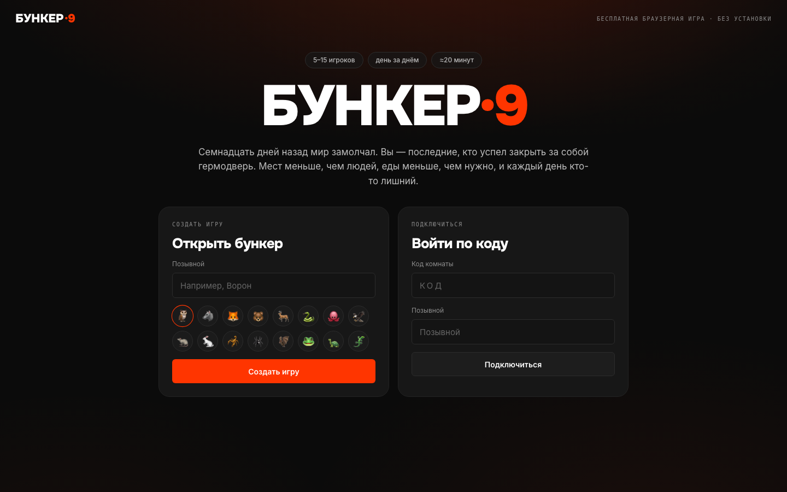

# БУНКЕР·9 — Сигнал тишины

Браузерная социальная игра для **5–15 человек** про выживание в бункере.
Аккаунты не нужны: комната создаётся по ссылке, вход — по четырёхзначному коду.
Ни ролей, ни «мафии»: у каждого пять личных карт (профессия, здоровье, багаж,
факт, привычка), а решение одно — кого изгнать, чтобы запасов хватило до
спасения.

Стек: **Bun** (сервер) + **Datastar 1.0.5** (HTML по SSE) + **SQLite**.
Поток событий сжимается на лету — **zstd**, с фолбэком на **brotli** и
`identity` по `Accept-Encoding`. Cloudflare вырезает `zstd` из запроса к
origin, поэтому через прод фактически уходит brotli, а напрямую (LAN,
локально) — zstd. Сторонних зависимостей в рантайме нет.




## Идея

Вы заперты в бункере «Кольцо-9». Снаружи — Тишина, внутри — еда, энергия и
медикаменты, которых заведомо меньше, чем нужно всем. Каждый день один факт о
себе выкладывается на стол, каждый вечер один человек покидает бункер.

Голосование — единственный способ сократить расход, но смена не может стать
меньше минимума: переусердствуете с изгнаниями — бункер некому будет
обслуживать, и спасение не придёт никому. Это и есть игра.

> Правила ранних версий (роли Живой/Врач/Заражённый, ночные убийства, шёпот
> заражённых) удалены. Движок в `src/engine.js` работает без ролей.

## Партия

### Лобби

- Хост создаёт бункер, получает код и ссылку-приглашение.
- Позывной — 2–16 символов, уникальный в комнате; аватарок 16.
- Хост настраивает **темп** (обычный/быстрый), добивает состав **ботами**
  (`+1`, `+5`, `+10`, «заполнить»), исключает игроков и запускает партию.
- Старт — от 5 человек, максимум 15.
- В лобби же показывается сценарий, день спасения и минимум смены.

### День

1. **Расход.** Бункер съедает еду и тратит энергию за каждого живого.
2. **Событие дня** — случайное из 22 (или сгенерированное моделью). Дельты
   масштабируются по составу: от ×0.6 на 5 игроков до ×1.5 на 15.
3. **Раскрытие по очереди.** Игроки ходят строго по одному: выбрать одну из
   своих карт → подтвердить конец хода. На ход 25 с (быстрый темп — 15 с);
   не успел — карта раскрывается случайно. Припасы с карты («ящик консервов»,
   «аптечка», «канистра») начисляются **в момент вскрытия**.
4. **Обсуждение.** 120 с (60 с). Подсказки считаются по фактам дня: сколько
   еды и дней до спасения, сколько человек до минимума смены, кто молчит,
   у кого скрыта карта, у кого больше всех раскрыто, сколько медикаментов.
5. **Голосование.** 35 с (20 с). Голосовать можно за любого живого, кроме
   себя, или воздержаться. Изгнан один лидер; при равенстве голосов или
   пустом бюллетене не уходит никто.

### Ночь

Ночных действий нет — бункер просто доживает до утра и платит за это.

- Если **еда или энергия на нуле**, ночь забирает одного выжившего.
- **Медикаменты — буфер:** одна тяжёлая ночь обходится без потерь за 1 медикамент.
- Жертва и причина («голод», «холод», «голод и холод») выбираются на входе в
  ночь; если модель включена, она пишет эпитафию по картам погибшего.
- Если ресурсы в порядке — «Ночь прошла спокойно».

### Финал

Партия заканчивается, когда:

| Условие                     | Итог                                        |
| --------------------------- | ------------------------------------------- |
| `день ≥ дня спасения`       | **СПАСЕНИЕ ПРИШЛО** — выжили все, кто дожил |
| живых меньше минимума смены | **БУНКЕР МОЛЧИТ**                           |
| живых не осталось           | **БУНКЕР МОЛЧИТ**                           |

В финале раскрываются все карты всех игроков, в ленте — разбор партии
(ИИ или детерминированная сводка). Хост может запустить рематч: состав,
позывные и аватарки сохраняются, карты раздаются заново.

## Экономика

Всё привязано к составу `N` — иначе на 15 игроков запасов хватало бы вдвое дольше.

| Параметр              | Формула                                | 5 игроков | 15 игроков |
| --------------------- | -------------------------------------- | --------- | ---------- |
| День спасения `R`     | `4 + ⌈N/6⌉`                            | 5         | 7          |
| Минимум смены         | `max(3, ⌈0.7·N⌉)`                      | 4         | 11         |
| Стартовая еда         | `(R−1)·N + 6`                          | 26        | 96         |
| Стартовая энергия     | `max(2, ⌈N/3⌉)·(R−1) + 4`              | 12        | 34         |
| Стартовые медикаменты | `2 + ⌈N/3⌉`                            | 4         | 7          |
| Расход еды в день     | `живые × (1 + кухня) + личные нормы`   | 5         | 15         |
| Расход энергии в день | `max(1, max(2, ⌈живые/3⌉) + электрик)` | 2         | 5          |

Стартовые запасы намеренно «чуть меньше, чем нужно дожить всем составом»:
разницу закрывают либо изгнания, либо удачные события, либо карты с припасами.

**Характеристики с эффектами** (16 значений в `content.js`):

- «повар» — смена ест вдвое меньше (`crewEat −0.5`);
- «стряпает из чего попало» — норма еды −¼ на человека;
- «электрик» — энергии −1 в день;
- «рыбак», «агроном», «ящик консервов», «мешок крупы», «канистра бензина»,
  «портативный генератор» — припасы при вскрытии карты;
- «медсестра», «фармацевт», «медицинская аптечка» — медикаменты;
- «аллергия на антибиотики» — личная норма еды +0.5 в день.

Пока карта не раскрыта, её эффект бункеру недоступен — включая припасы.

## Настройки и режимы

Отдельных «режимов» нет: одна правила-схема, несколько переключателей.

### Темп

| Фаза                  | Обычный | Быстрый |
| --------------------- | ------- | ------- |
| Интро                 | 20 с    | 12 с    |
| Раскрытие (на игрока) | 25 с    | 15 с    |
| Обсуждение            | 120 с   | 60 с    |
| Голосование           | 35 с    | 20 с    |
| Ночь                  | 40 с    | 25 с    |

Темп меняет только хост и только в лобби. В игре хост может **пропустить
текущую фазу** — это ускоряет партию, когда все уже высказались.

### Боты

Хост добивает состав ботами в лобби. Бот — обычный игрок с флагом `isBot`:
раскрывает карты, голосует и подтверждает ходы сам, с задержкой ~1.2 с.
Так можно играть одному или проверять партию без друзей. Боты не занимают
SSE-потоки и не «отваливаются» при реконнекте.

### Сценарии

6 статичных сценариев в `src/content.js` (`Химический шторм`, `Карантин`,
`Долгая зима`, `Тёмная вода`, `Сигнал извне`, `Последний состав`) выбираются
случайно на старте. Выбора сценария в интерфейсе нет. С ключом ИИ модель
пишет свой (`title/premise/threat`) при создании комнаты.

### ИИ (опционально)

Шесть функций, все с фолбэком — без ключа игра работает как раньше:

| Что                                   | Без ключа                        |
| ------------------------------------- | -------------------------------- |
| Сюжет партии (`title/premise/threat`) | сценарий из `content.js`         |
| Персонажи: N×5 карт в лобби           | карты из пулов                   |
| Событие дня                           | статичные 22 события             |
| Подсказки на обсуждении               | арифметика `discussionHints`     |
| Причина/эпитафия ночной потери        | «Ночь на пределе — голод/холод»  |
| Разбор партии и вердикт в финале      | детерминированная сводка из лога |

Вызовы асинхронные: фаза модели не ждёт, ошибка или таймаут = фолбэк.
Стоимость — порядка 50 вызовов на партию на дешёвой модели.

### Реконнект

- Cookie `bunker_sid` живёт 30 дней (`HttpOnly`, `SameSite=Lax`).
- Разрыв связи не убивает персонажа: вкладка возвращается по сессии и токену.
- В лобби отключившийся игрок удаляется через 120 с; в игре — остаётся.
- После рестарта сервера комнаты, сессии и текущая фаза поднимаются из SQLite,
  таймеры вооружаются заново, вкладки оживают по SSE без F5.
- Брошенная комната (нет живых SSE-потоков и изменений) убирается через 30 минут.

## Запуск

Нужен **Bun 1.1+**; на этой машине — `~/.bun/bin/bun` (1.4.4).

```bash
cd ~/Desktop/bunker
bun start                 # http://localhost:3100
```

Сервер печатает адрес в локальной сети — по нему заходят друзья в том же Wi-Fi.
Вход по интернету — туннель или проброс порта:

```bash
cloudflared tunnel --url http://localhost:3100
ngrok http 3100
```

### Прод

```bash
VPS_HOST=45.15.67.190 ./deploy/vps/deploy.sh   # гейт verify внутри
./deploy/smoke.sh                              # проверка https://bunker9.lol снаружи
```

Схема прода: `интернет → Cloudflare → Caddy (TLS) → bunker9.service :3100 → SQLite`.
Сервис слушает только `127.0.0.1` (`HOST=127.0.0.1`), наружу выставлен Caddy.
Бинарник собирается на ноутбуке (`bun build --compile --bytecode
--target=bun-linux-x64`) и копируется по ssh; bun на VPS не нужен.

### Переменные окружения

| Переменная             | По умолчанию                  | Назначение                                                     |
| ---------------------- | ----------------------------- | -------------------------------------------------------------- |
| `PORT`                 | `3100`                        | порт HTTP-сервера                                              |
| `HOST`                 | `0.0.0.0`                     | интерфейс; на проде `127.0.0.1`                                |
| `PUBLIC_DIR`           | `./public`                    | каталог статики                                                |
| `BUNKER_DB`            | `./data/bunker.db`            | путь к SQLite                                                  |
| `BUNKER_IDLE_MIN`      | `30`                          | через сколько минут убирать брошенную комнату                  |
| `BUNKER_TEST`          | —                             | ускоренные таймеры (0.7–0.9 с) для тестов                      |
| `BUNKER_AI`            | `live` при ключе, иначе `off` | `live` / `mock` / `off`                                        |
| `BUNKER_AI_KEY`        | —                             | ключ OpenAI-совместимого API (только на сервере)               |
| `BUNKER_AI_URL`        | `https://api.openai.com/v1`   | базовый URL API                                                |
| `BUNKER_AI_MODEL`      | `gpt-4o-mini`                 | модель                                                         |
| `BUNKER_AI_TIMEOUT_MS` | `12000`                       | таймаут одного вызова                                          |
| `BUNKER_AI_REASONING`  | —                             | `reasoning_effort`; для DeepSeek — `none` (иначе пустой ответ) |
| `BUNKER_AI_SESSION`    | случайный на процесс          | id сессии для OpenCode Go (`x-opencode-session`)               |

Служебные точки: `GET /health` (комнаты, сессии, база), `GET /api/games`
(последние 10 партий), `GET /stream` (SSE, zstd/brotli), `POST /act/:cmd` (действия).

## Тесты

```bash
bun run verify              # гейт: типы, формат, боты 5/15, HTTP, ходы,
                            # экономика, характеристики, правила, ИИ, боты
SKIP_BOTS=1 bun run verify  # только типы и формат
```

`verify` сам поднимает серверы на свободных портах с временными базами —
рядом ничего держать не нужно. Ускоренные таймеры (`BUNKER_TEST=1`) идут
только для ботов: HTTP-проверкам нужны настоящие, иначе фазы уезжают вперёд.

| Команда                                             | Что проверяет                                                        |
| --------------------------------------------------- | -------------------------------------------------------------------- |
| `bun test/sim-bun.mjs` · `BOTS=15 …`                | партия ботов по HTTP/SSE, приватность скрытых карт                   |
| `bun tools/http-e2e.mjs`                            | лендинг, создание/вход, ошибки форм, битая сессия                    |
| `bun tools/stale-session-e2e.mjs`                   | протухшая сессия и повторный вход                                    |
| `bun tools/turn-e2e.mjs`                            | пошаговое раскрытие: чужой ход, подтверждение, свои карты            |
| `bun tools/traits-e2e.mjs`                          | характеристики: припасы при вскрытии, повар, аллергия, электрик      |
| `bun tools/economy-e2e.mjs`                         | стартовые запасы и суточный расход растут с составом                 |
| `bun tools/rules-e2e.mjs`                           | голос за себя, хост после смерти, позывные, антифлуд, эпитафия       |
| `bun tools/ai-e2e.mjs`                              | ИИ на `BUNKER_AI=mock`: сюжет, персонажи, событие, подсказки, разбор |
| `bun tools/bots-e2e.mjs`                            | добавление ботов хостом и их самостоятельная игра                    |
| `bun tools/db-e2e.mjs`                              | персистентность: рестарт сервера, комната, фаза, cookie              |
| `bun tools/balance-sim.mjs`                         | 120 партий на каждый состав: винрейты, дни, кризисы (отчёт)          |
| `bun tools/ui-e2e.mjs`                              | браузер: таймер, оживание вкладки после рестарта                     |
| `SITE=http://localhost:3102 bun tools/deep-e2e.mjs` | 52 проверки полной партии в браузере + мобилка 390 px                |

`sim-bun` и `http-e2e` ходят на готовый сервер по `SITE` (по умолчанию
`http://localhost:3101`), остальные поднимают свой. `deep-e2e` — исключение:
ему нужен запущенный сервер, по умолчанию `http://localhost:3102`.

Браузерные проверки ищут `chrome-headless-shell` в кеше Playwright
(`~/Library/Caches/ms-playwright/chromium_headless_shell-1254/…`) — на другой
машине путь нужно поправить. `deep-e2e` требует уже запущенный сервер,
`ui-e2e` и `db-e2e` поднимают свой.

## Структура

```
server.ts            Bun.serve: SSE /stream, POST /act/:cmd, лендинг, статика
src/engine.js        правила: комнаты, фазы, экономика, голосование, ночь, финал
src/render.ts        рендер состояния в HTML (патчи по id для Datastar)
src/store.ts         bun:sqlite: rooms, sessions, games; отложенная запись
src/ai.ts            OpenAI-совместимый клиент, шесть генераторов, mock
src/content.js       карты, эффекты, события, сценарии, концовки, аватарки
public/              style.css, sound.js (WebAudio-синтез), vendor/datastar-1.0.5.js
tools/               e2e-проверки, balance-sim, снимки UI
test/sim-bun.mjs     боты по HTTP/SSE
deploy/              smoke, туннель (резерв), vps/ (bootstrap, deploy, systemd, Caddyfile)
data/                bunker.db (в git не попадает)
screenshots/         кадры текущего UI
```

## Ограничения

- Нет аккаунтов, модерации имён/сообщений и бана: игра рассчитана на друзей.
- Один процесс — одна общая комната-сервер; несколько комнат живут в нём
  одновременно, но горизонтального масштабирования нет (состояние в памяти + SQLite).
- Напрямую TLS нет: в проде его держит Caddy, на ноутбуке — туннель.
- Браузерные тесты привязаны к macOS и кешу Playwright.
- `tools/audit-mobile.mjs` — наследие эпохи socket.io: требует `socket.io-client`,
  которого в проекте больше нет. Для мобилки используйте `deep-e2e`.
